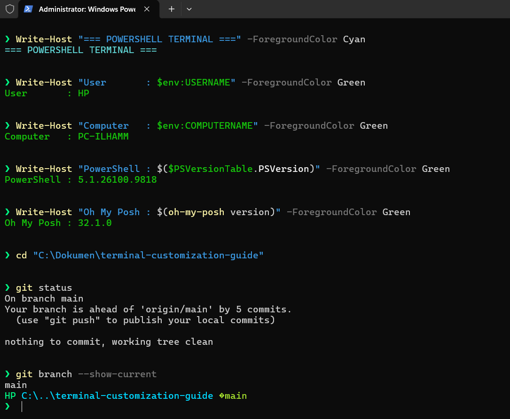
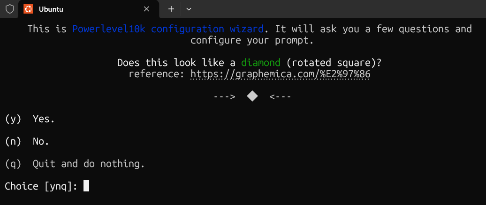
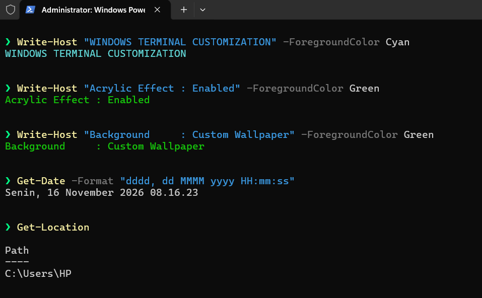
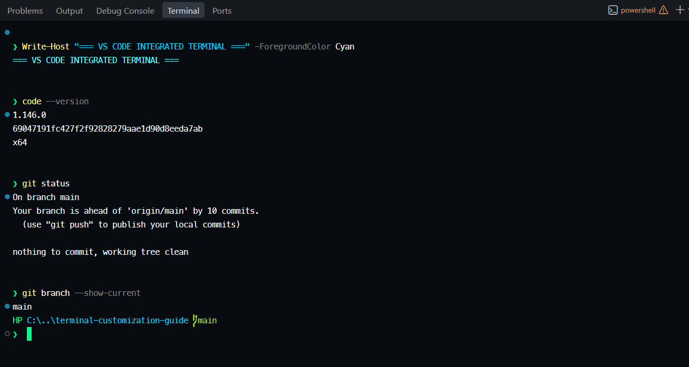

# Terminal Customization Guide


**A Complete Guide to Building a Beautiful and Productive Terminal Environment.**

Panduan lengkap untuk mengustomisasi tampilan dan lingkungan terminal agar lebih menarik, nyaman digunakan, dan produktif.

---

## Overview

**Terminal Customization Guide** adalah proyek dokumentasi open source yang berisi panduan untuk mengustomisasi tampilan dan lingkungan terminal, khususnya di lingkungan Windows dan WSL.

Proyek ini memanfaatkan berbagai teknologi, seperti Windows Terminal, PowerShell, Windows Subsystem for Linux (WSL), Ubuntu, Zsh, Oh My Zsh, Powerlevel10k, Oh My Posh, dan Visual Studio Code.

Tidak hanya menyediakan tutorial, repository ini juga menyediakan contoh file konfigurasi, screenshot hasil kustomisasi, serta koleksi wallpaper yang dapat digunakan sebagai latar belakang terminal.

Proyek ini dibuat agar siapa saja, termasuk pengguna yang baru mengenal terminal, dapat mengikuti proses kustomisasi secara bertahap.

## Preview

Berikut beberapa hasil kustomisasi terminal yang didokumentasikan dalam proyek ini.

### PowerShell — Oh My Posh



Screenshot ini memperlihatkan tampilan prompt PowerShell setelah menggunakan Oh My Posh, termasuk informasi direktori dan elemen visual pada prompt.

### Ubuntu — Zsh & Powerlevel10k



Contoh tampilan terminal Ubuntu yang menggunakan Zsh dan tema Powerlevel10k.

### Windows Terminal — Acrylic



Contoh tampilan Windows Terminal dengan efek Acrylic dan pengaturan visual.

### Visual Studio Code — Integrated Terminal



Contoh penggunaan terminal terintegrasi di dalam Visual Studio Code.

---

## Features

Beberapa hal yang dibahas dan disediakan dalam repository ini:

- **Windows Terminal Customization** — Mengatur warna, transparansi, Acrylic, dan background image.
- **PowerShell Customization** — Menggunakan Oh My Posh untuk membuat prompt terminal lebih informatif.
- **WSL Ubuntu Setup** — Menyiapkan lingkungan Linux menggunakan Windows Subsystem for Linux.
- **Zsh & Oh My Zsh** — Menggunakan Zsh sebagai shell dengan berbagai fitur kustomisasi.
- **Powerlevel10k Theme** — Mengatur tampilan prompt Zsh dengan informasi direktori, Git, dan simbol khusus.
- **VS Code Integrated Terminal** — Mengatur font, warna, dan tampilan terminal di Visual Studio Code.
- **Configuration Examples** — Menyediakan file konfigurasi yang dapat dipelajari dan disesuaikan.
- **Wallpaper Collection** — Menyediakan koleksi wallpaper untuk Windows Terminal.
- **Troubleshooting Guide** — Membantu pengguna memahami dan mengatasi masalah selama proses konfigurasi.

---

## Documentation

Dokumentasi disusun secara bertahap agar pengguna dapat mengikuti proses konfigurasi dengan lebih mudah.

| No. | Documentation | Description |
|---|---|---|
| 01 | [WSL Ubuntu & Zsh](docs/01-wsl-ubuntu-zsh.md) | Persiapan WSL Ubuntu dan penggunaan Zsh |
| 02 | [Powerlevel10k](docs/02-powerlevel10k.md) | Instalasi dan kustomisasi prompt Powerlevel10k |
| 03 | [PowerShell & Oh My Posh](docs/03-powershell-oh-my-posh.md) | Kustomisasi prompt PowerShell menggunakan Oh My Posh |
| 04 | [VS Code Terminal](docs/04-vscode-terminal.md) | Pengaturan terminal terintegrasi Visual Studio Code |
| 05 | [macOS Inspired Look](docs/05-macos-inspired-look.md) | Kustomisasi tampilan terminal dengan inspirasi desain macOS |
| 06 | [Troubleshooting](docs/06-troubleshooting.md) | Panduan mengatasi masalah konfigurasi terminal |

**Rekomendasi:** Jika baru pertama kali mengikuti proyek ini, mulailah dari dokumentasi nomor 01 dan lanjutkan secara berurutan.

---

## Configuration Collection

Folder `configs/` menyediakan kumpulan contoh file konfigurasi yang dapat digunakan sebagai referensi atau titik awal kustomisasi.

```text
configs/
├── powershell/
├── vscode/
├── zsh/
└── README.md
```

### Available Configurations

| Directory | Example File | Description |
|---|---|---|
| `powershell/` | `macos-theme.omp.json` | Tema Oh My Posh untuk PowerShell |
| `vscode/` | `settings.example.json` | Contoh pengaturan font dan warna terminal VS Code |
| `zsh/` | `zshrc.example` | Contoh konfigurasi Zsh dan Oh My Zsh |

Setiap file memiliki fungsi dan cara penggunaan yang berbeda.

**Penting:** File konfigurasi merupakan contoh yang dapat disesuaikan. Periksa isinya sebelum digunakan, sesuaikan lokasi file dan font dengan perangkat masing-masing, serta buat cadangan konfigurasi pribadi sebelum menggantinya.

Panduan lebih lengkap tersedia di [configs/README.md](configs/README.md).

---

## Wallpaper Collection

Repository ini juga menyediakan koleksi wallpaper yang dapat digunakan sebagai background Windows Terminal.

Wallpaper dikelompokkan menjadi tiga kategori utama.

### Nature Collection

Koleksi wallpaper bertema pemandangan alam.

**01. Dark Forest**


**02. Dark Forest 2**


**03. Dark Forest 3**


**04. Dark Mountain**


**05. Dark Mountain 2**


**06. Dark Mountain 3**


**07. Dark Mountain 4**


### Abstract Collection

Koleksi wallpaper dengan desain modern dan artistik.

**01. Dark Abstract**


**02. Dark Abstract 2**


### Minimal Collection

Koleksi wallpaper dengan tampilan sederhana dan minimalis.

**01. Dark Gradient**


**02. Dark Gradient 2**


Untuk melihat katalog lengkap dan panduan pemasangan, kunjungi [Wallpaper Collection](assets/wallpapers/README.md).

---

## Screenshots

Folder `assets/screenshots/` berisi dokumentasi visual hasil kustomisasi terminal.

```text
assets/screenshots/
├── powershell/
│   ├── oh-my-posh-git.png
│   └── oh-my-posh-prompt.png
│
├── ubuntu-zsh/
│   ├── powerlevel10k-prompt.png
│   └── zsh-terminal.png
│
├── vscode/
│   └── integrated-terminal.png
│
└── windows-terminal/
    ├── acrylic-background.png
    └── terminal-color-theme.png
```

Screenshot digunakan sebagai referensi visual agar pengguna dapat membandingkan hasil konfigurasi dengan tampilan terminal masing-masing.

Lihat [Screenshots Documentation](assets/screenshots/README.md) untuk informasi lebih lanjut.

---

## Getting Started

Sebelum mengikuti tutorial, pastikan perangkat sudah memenuhi kebutuhan dasar berikut.

### Requirements

| Requirement | Description |
|---|---|
| Operating System | Windows yang mendukung fitur terkait |
| Terminal | Windows Terminal |
| Shell | PowerShell dan/atau Ubuntu WSL |
| Linux Environment | Ubuntu melalui WSL |
| Editor | Visual Studio Code |
| Version Control | Git |
| Font | MesloLGS NF atau font Nerd Font yang sesuai |

Beberapa kebutuhan bersifat opsional dan bergantung pada tutorial yang ingin diikuti.

### 1. Clone Repository

Buka PowerShell atau terminal lainnya, kemudian jalankan:

```bash
git clone https://github.com/illhammf/terminal-customization-guide.git
```

### 2. Masuk ke Direktori Repository

```bash
cd terminal-customization-guide
```

### 3. Buka Repository di VS Code

Jika Visual Studio Code sudah terpasang, jalankan:

```bash
code .
```

### 4. Mulai Membaca Dokumentasi

Buka folder `docs/`, kemudian ikuti tutorial sesuai urutan yang tersedia.

### 5. Gunakan Contoh Konfigurasi

Jika membutuhkan contoh file konfigurasi, buka folder `configs/` dan pilih konfigurasi yang sesuai dengan lingkungan terminal yang digunakan.

### 6. Gunakan Wallpaper

Jika ingin mengubah background Windows Terminal, buka folder `assets/wallpapers/`, pilih wallpaper yang tersedia, kemudian ikuti panduan pemasangan di README folder tersebut.

---

## Repository Structure

Berikut struktur utama repository:

```text
terminal-customization-guide/
│
├── assets/
│   ├── screenshots/
│   │   ├── powershell/
│   │   ├── ubuntu-zsh/
│   │   ├── windows-terminal/
│   │   ├── vscode/
│   │   └── README.md
│   │
│   ├── wallpapers/
│   │   ├── nature/
│   │   ├── abstract/
│   │   ├── minimal/
│   │   └── README.md
│   │
│   └── README.md
│
├── configs/
│   ├── powershell/
│   ├── vscode/
│   ├── zsh/
│   └── README.md
│
├── docs/
│   ├── 01-wsl-ubuntu-zsh.md
│   ├── 02-powerlevel10k.md
│   ├── 03-powershell-oh-my-posh.md
│   ├── 04-vscode-terminal.md
│   ├── 05-macos-inspired-look.md
│   └── 06-troubleshooting.md
│
├── CONTRIBUTING.md
├── LICENSE
└── README.md
```

### Directory Overview

| Directory / File | Purpose |
|---|---|
| `assets/` | Menyimpan seluruh materi visual proyek |
| `assets/screenshots/` | Screenshot hasil kustomisasi terminal |
| `assets/wallpapers/` | Koleksi wallpaper untuk terminal |
| `configs/` | Contoh file konfigurasi |
| `docs/` | Tutorial dan dokumentasi teknis |
| `CONTRIBUTING.md` | Panduan untuk kontributor |
| `LICENSE` | Ketentuan lisensi proyek |
| `README.md` | Halaman utama repository |

---

## Contributing

Kontribusi terbuka bagi siapa saja yang ingin membantu mengembangkan proyek ini.

Beberapa kontribusi yang dapat dilakukan:

- Memperbaiki dokumentasi.
- Menambahkan tutorial baru.
- Menambahkan konfigurasi terminal.
- Menambahkan wallpaper.
- Menambahkan screenshot.
- Melaporkan bug.
- Mengusulkan fitur atau pengembangan baru.

Sebelum berkontribusi, silakan baca [CONTRIBUTING.md](CONTRIBUTING.md).

Setiap kontribusi yang relevan dan bermanfaat sangat dihargai.

---

## License

Proyek ini menggunakan **MIT License**.

Kamu dapat menggunakan, mempelajari, memodifikasi, dan mendistribusikan materi proyek sesuai ketentuan lisensi.

Lihat file [LICENSE](LICENSE) untuk informasi lengkap.

Perlu diperhatikan bahwa aset pihak ketiga, seperti font, gambar, dan merek, dapat memiliki ketentuan lisensi tersendiri.

---

## Acknowledgements

Proyek ini memanfaatkan berbagai aplikasi dan teknologi yang membantu proses kustomisasi terminal.

Terima kasih kepada para pengembang dan komunitas di balik:

- [Windows Terminal](https://github.com/microsoft/terminal)
- [Windows Subsystem for Linux](https://learn.microsoft.com/windows/wsl/)
- [Oh My Zsh](https://ohmyz.sh/)
- [Powerlevel10k](https://github.com/romkatv/powerlevel10k)
- [Oh My Posh](https://ohmyposh.dev/)
- [Visual Studio Code](https://code.visualstudio.com/)
- [Git](https://git-scm.com/)

---

**Build a terminal that feels like your own.**

Made for learning, customization, and the developer community.

[GitHub Profile](https://github.com/illhammf) · [Report an Issue](https://github.com/illhammf/terminal-customization-guide/issues) · [Repository](https://github.com/illhammf/terminal-customization-guide)