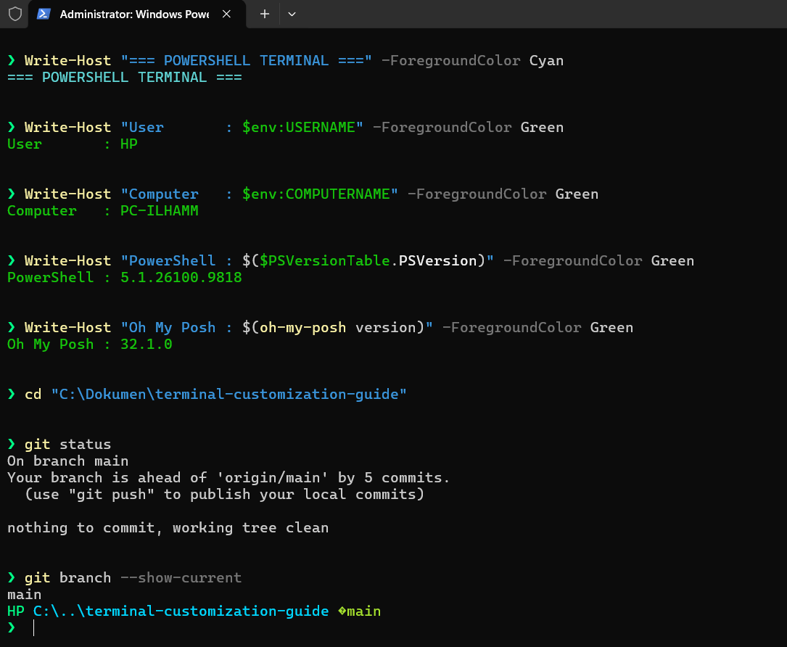

# Assets

Folder `assets/` merupakan tempat penyimpanan berbagai file pendukung visual yang digunakan dalam proyek **Terminal Customization Guide**.

Folder ini berisi screenshot, wallpaper, dan materi visual lainnya yang membantu pengguna memahami hasil akhir dari proses kustomisasi terminal.

Tujuan utama folder ini adalah menyediakan dokumentasi visual agar setiap tutorial tidak hanya berisi penjelasan dan perintah, tetapi juga memiliki contoh tampilan yang dapat dijadikan referensi.

---

## Daftar Isi

- [1. Tentang Assets](#1-tentang-assets)
- [2. Struktur Folder](#2-struktur-folder)
- [3. Screenshots](#3-screenshots)
- [4. Wallpapers](#4-wallpapers)
- [5. Panduan Menambahkan File](#5-panduan-menambahkan-file)
- [6. Penggunaan Assets dalam Dokumentasi](#6-penggunaan-assets-dalam-dokumentasi)
- [7. Ketentuan Penggunaan](#7-ketentuan-penggunaan)

---

## 1. Tentang Assets

Dalam dokumentasi teknis, gambar memiliki peran penting untuk membantu pembaca memahami suatu proses.

Misalnya, ketika tutorial menjelaskan cara memasang Powerlevel10k, pengguna dapat melihat screenshot hasil akhirnya sehingga lebih mudah membandingkan tampilannya dengan terminal mereka sendiri.

Karena itu, folder `assets/` digunakan untuk:

- Menyimpan screenshot hasil kustomisasi terminal.
- Menyediakan contoh tampilan setiap lingkungan terminal.
- Menyimpan wallpaper yang digunakan dalam tutorial.
- Mendukung penjelasan visual di dalam file dokumentasi.
- Menjaga semua materi visual tetap terorganisasi.

---

## 2. Struktur Folder

Struktur direktori yang digunakan:

```text
assets/
│
├── screenshots/
│   ├── powershell/
│   ├── ubuntu-zsh/
│   ├── windows-terminal/
│   └── vscode/
│
├── wallpapers/
│
└── README.md
```

Setiap direktori memiliki tujuan yang berbeda agar file lebih mudah ditemukan dan dikelola.

---

## 3. Screenshots

**Lokasi:** `assets/screenshots/`

Folder ini digunakan untuk menyimpan tangkapan layar dari hasil konfigurasi terminal.

Screenshot dapat digunakan sebagai bukti visual sekaligus referensi bagi pengguna yang mengikuti tutorial.

### Kategori Screenshot

| Direktori | Isi |
|---|---|
| `powershell/` | Tampilan PowerShell dengan Oh My Posh |
| `ubuntu-zsh/` | Tampilan Ubuntu dengan Zsh dan Powerlevel10k |
| `windows-terminal/` | Tampilan Windows Terminal dengan tema dan wallpaper |
| `vscode/` | Tampilan terminal terintegrasi Visual Studio Code |

### Contoh Screenshot yang Dapat Ditambahkan

**PowerShell**
- Tampilan prompt Oh My Posh.
- Informasi direktori dan Git.
- Tampilan prompt setelah menjalankan perintah.

**Ubuntu Zsh**
- Tampilan Zsh setelah instalasi.
- Tampilan Powerlevel10k.
- Hasil konfigurasi font dan simbol.

**Windows Terminal**
- Tampilan terminal dengan tema gelap.
- Tampilan Acrylic atau transparansi.
- Tampilan terminal menggunakan wallpaper.

**VS Code**
- Tampilan integrated terminal.
- Tampilan font dan warna terminal.
- Penggunaan PowerShell dan WSL di VS Code.

---

## 4. Wallpapers

**Lokasi:** `assets/wallpapers/`

Folder ini digunakan untuk menyimpan gambar latar belakang yang digunakan dalam konfigurasi Windows Terminal.

Wallpaper dapat digunakan untuk membuat tampilan terminal lebih menarik dan memberikan nuansa visual yang konsisten.

### Contoh Penggunaan

Wallpaper dapat diterapkan melalui pengaturan Windows Terminal menggunakan properti seperti:

- `backgroundImage`
- `backgroundImageOpacity`
- `backgroundImageAlignment`
- `backgroundImageStretchMode`

Lokasi wallpaper yang digunakan dalam konfigurasi harus disesuaikan dengan lokasi file pada perangkat masing-masing.

### Catatan

Tidak semua wallpaper harus disertakan dalam repository. Gunakan gambar yang memang boleh dibagikan dan pastikan ukuran file tetap wajar agar repository tidak terlalu besar.

---

## 5. Panduan Menambahkan File

Agar folder tetap rapi, gunakan beberapa aturan berikut.

### 5.1 Penamaan File

Gunakan nama file yang jelas, deskriptif, dan konsisten.

Contoh:

```text
powershell/
├── oh-my-posh-prompt.png
└── oh-my-posh-git-status.png

ubuntu-zsh/
├── zsh-initial-setup.png
└── powerlevel10k-final.png

windows-terminal/
├── acrylic-background.png
└── wallpaper-terminal.png

vscode/
├── integrated-terminal.png
└── terminal-color-theme.png
```

Hindari nama file yang terlalu umum seperti:

```text
image1.png
screenshot2.png
hasil-baru.png
final-fix-terbaru.png
```

### 5.2 Format File

Format yang disarankan:

| Jenis File | Format |
|---|---|
| Screenshot | PNG atau JPG |
| Wallpaper | JPG, PNG, atau WebP |
| Gambar pendukung | PNG, JPG, atau WebP |

### 5.3 Kualitas Gambar

Usahakan gambar memiliki kualitas yang cukup baik agar teks terminal masih dapat dibaca.

Hindari screenshot yang terlalu kecil, buram, atau terpotong pada bagian penting.

---

## 6. Penggunaan Assets dalam Dokumentasi

File gambar dari folder `assets/` dapat ditampilkan langsung di dalam file Markdown menggunakan sintaks:

```markdown

```

Contoh lainnya:

```markdown

```

Pastikan alamat relatif gambar sesuai dengan lokasi file Markdown yang menggunakannya.

Dengan cara ini, screenshot dapat ditampilkan langsung di GitHub tanpa perlu membuka file gambar secara terpisah.

---

## 7. Ketentuan Penggunaan

Beberapa hal yang perlu diperhatikan ketika menambahkan materi visual:

1. Gunakan screenshot dari hasil konfigurasi yang benar-benar tersedia.
2. Jangan menggunakan screenshot yang menampilkan informasi pribadi atau kredensial.
3. Gunakan wallpaper yang memiliki izin penggunaan dan distribusi yang sesuai.
4. Hindari menambahkan gambar duplikat.
5. Gunakan nama file yang mudah dipahami.
6. Pastikan gambar relevan dengan tutorial.
7. Usahakan ukuran file tidak terlalu besar.

---

**Bagian dari:** [Terminal Customization Guide](../README.md)

Folder `assets/` akan terus dikembangkan seiring bertambahnya tutorial dan contoh konfigurasi dalam repository ini.