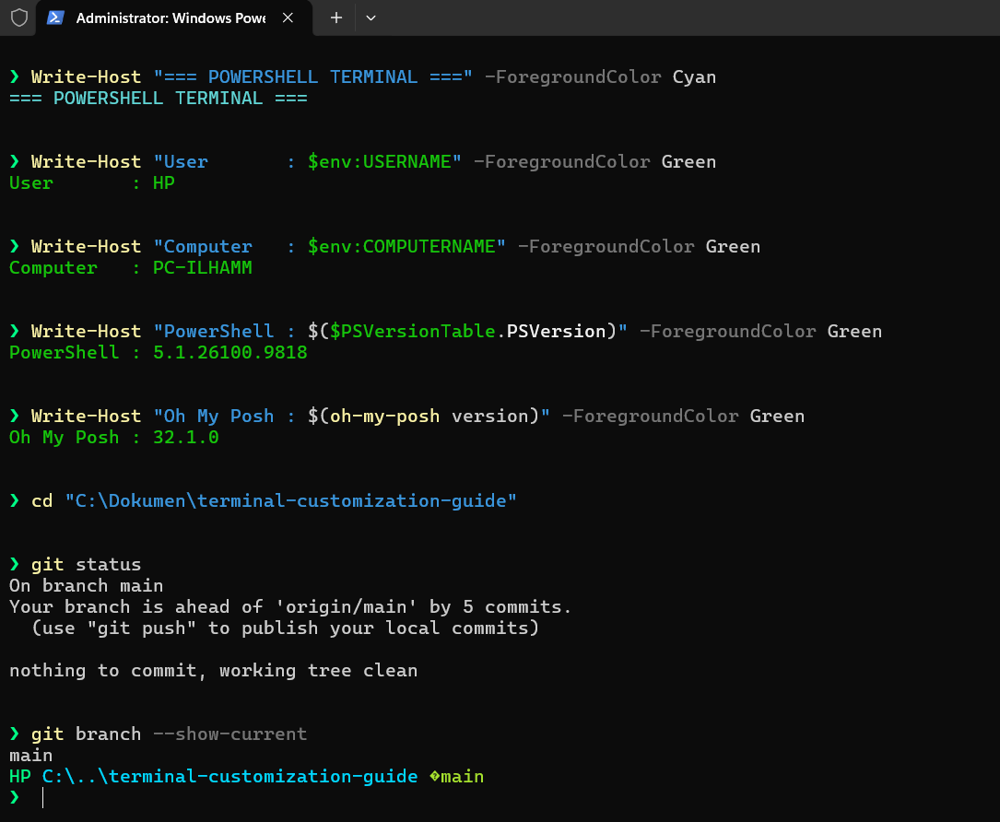
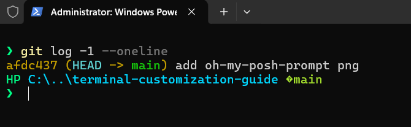
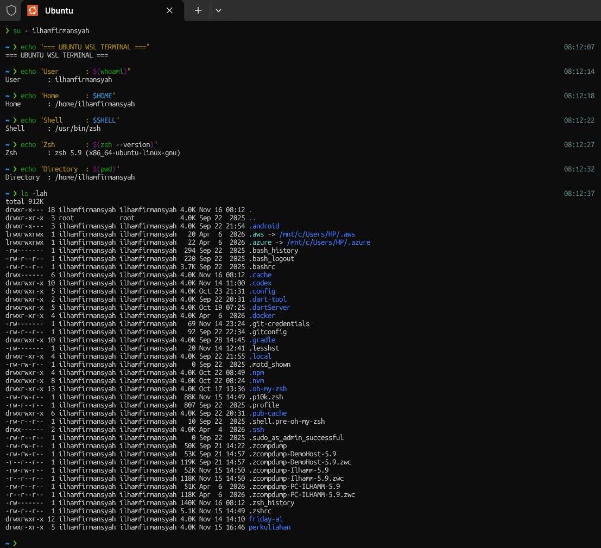
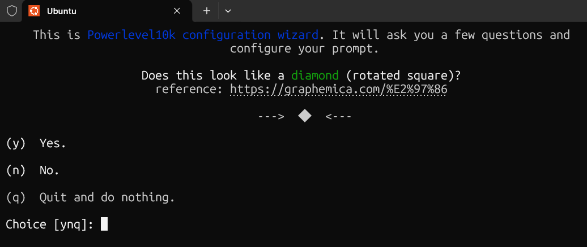
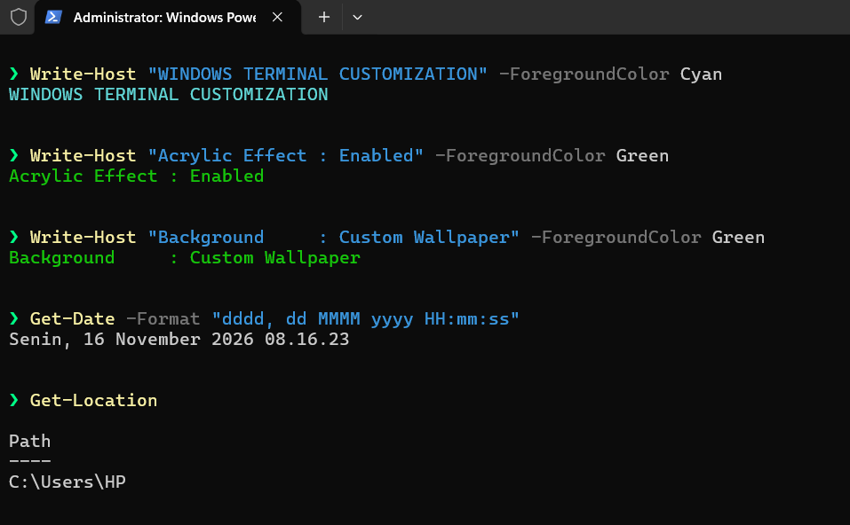
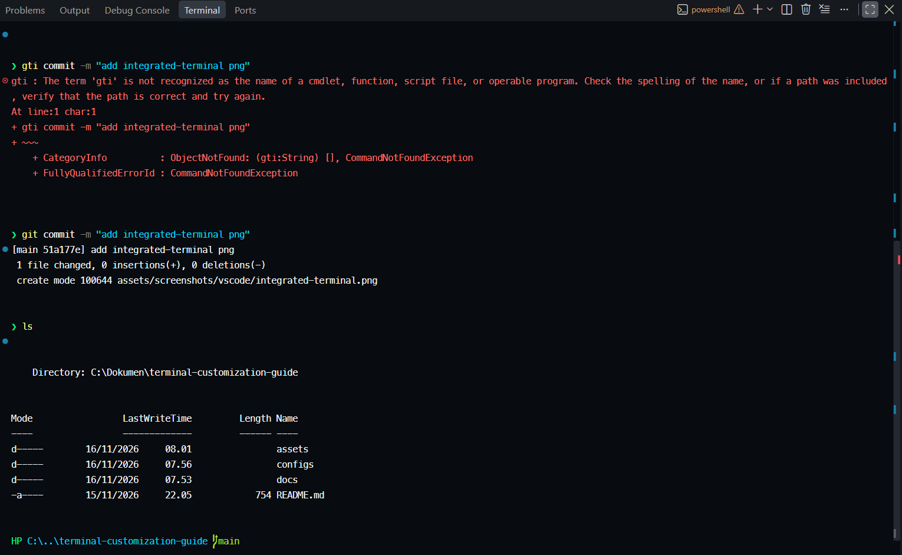
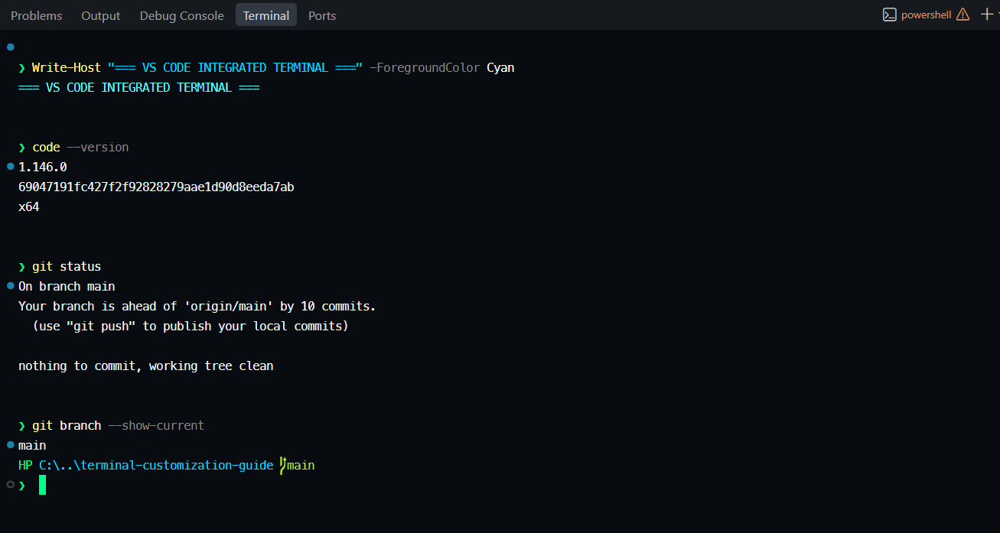

# Terminal Customization Screenshots

Folder ini berisi kumpulan screenshot hasil kustomisasi terminal dalam proyek **Terminal Customization Guide**.

Screenshot digunakan sebagai dokumentasi visual untuk memperlihatkan tampilan terminal setelah proses instalasi dan konfigurasi dilakukan.

Melalui dokumentasi ini, pengguna dapat melihat contoh tampilan PowerShell, Ubuntu dengan Zsh, Windows Terminal, dan terminal terintegrasi Visual Studio Code.

> **Catatan:** Screenshot pada halaman ini merupakan referensi visual. Tampilan pada perangkat masing-masing dapat berbeda tergantung sistem operasi, font, tema, dan konfigurasi yang digunakan.

---

## Daftar Isi

- [1. PowerShell](#1-powershell)
- [2. Ubuntu Zsh](#2-ubuntu-zsh)
- [3. Windows Terminal](#3-windows-terminal)
- [4. Visual Studio Code](#4-visual-studio-code)
- [5. Struktur Screenshot](#5-struktur-screenshot)
- [6. Cara Menambahkan Screenshot](#6-cara-menambahkan-screenshot)

---

## 1. PowerShell

**Lokasi:** `powershell/`

Bagian ini berisi screenshot tampilan PowerShell yang telah dikustomisasi menggunakan **Oh My Posh**.

Oh My Posh digunakan untuk mempercantik tampilan prompt terminal dengan menampilkan informasi seperti nama pengguna, direktori aktif, dan status Git.

### 1.1 Oh My Posh Prompt

File: `powershell/oh-my-posh-prompt.png`



Screenshot ini digunakan untuk memperlihatkan tampilan utama prompt PowerShell setelah menggunakan Oh My Posh.

Beberapa elemen yang dapat diperhatikan:

- Informasi pengguna.
- Direktori aktif.
- Warna dan simbol prompt.
- Tampilan font yang mendukung karakter khusus.

### 1.2 Oh My Posh Git

File: `powershell/oh-my-posh-git.png`



Screenshot ini digunakan untuk memperlihatkan tampilan PowerShell ketika bekerja di dalam repository Git.

Informasi Git dapat membantu pengguna mengenali konteks repository dan status pekerjaan langsung dari terminal.

---

## 2. Ubuntu Zsh

**Lokasi:** `ubuntu-zsh/`

Bagian ini berisi screenshot terminal Ubuntu melalui Windows Subsystem for Linux (WSL) yang menggunakan Zsh dan Powerlevel10k.

Zsh merupakan shell alternatif yang menyediakan berbagai fitur kustomisasi. Sementara itu, Powerlevel10k digunakan untuk mengatur tampilan prompt agar lebih informatif dan menarik.

### 2.1 Zsh Terminal

File: `ubuntu-zsh/zsh-terminal.png`



Screenshot ini digunakan untuk memperlihatkan lingkungan terminal Ubuntu yang menggunakan Zsh.

Beberapa hal yang menjadi perhatian:

- Penggunaan Zsh sebagai shell.
- Tampilan prompt terminal.
- Informasi direktori aktif.
- Penggunaan font yang mendukung simbol terminal.

### 2.2 Powerlevel10k Prompt

File: `ubuntu-zsh/powerlevel10k-prompt.png`



Screenshot ini digunakan untuk memperlihatkan hasil kustomisasi prompt menggunakan Powerlevel10k.

Powerlevel10k dapat menampilkan berbagai informasi seperti:

- Nama pengguna.
- Direktori aktif.
- Informasi Git.
- Simbol dan ikon khusus.
- Informasi tambahan sesuai konfigurasi.

---

## 3. Windows Terminal

**Lokasi:** `windows-terminal/`

Bagian ini berisi screenshot kustomisasi tampilan aplikasi Windows Terminal.

Windows Terminal mendukung berbagai pengaturan visual, seperti warna, transparansi, Acrylic, dan gambar latar belakang.

### 3.1 Acrylic Background

File: `windows-terminal/acrylic-background.png`



Screenshot ini digunakan untuk memperlihatkan tampilan Windows Terminal dengan efek transparansi atau Acrylic.

Efek tersebut dapat memberikan kesan terminal yang lebih modern dengan tampilan latar belakang yang tidak sepenuhnya solid.

### 3.2 Terminal Color Theme

File: `windows-terminal/terminal-color-theme.png`



Screenshot ini digunakan untuk memperlihatkan pengaturan warna pada Windows Terminal.

Kustomisasi warna dapat mencakup:

- Warna latar belakang.
- Warna teks.
- Warna kursor.
- Warna teks berdasarkan jenis keluaran terminal.

Pengaturan ini membantu menciptakan tampilan yang konsisten dan nyaman digunakan.

---

## 4. Visual Studio Code

**Lokasi:** `vscode/`

Bagian ini berisi screenshot terminal terintegrasi di Visual Studio Code.

VS Code menyediakan terminal bawaan yang memungkinkan pengguna menjalankan PowerShell, WSL, dan shell lainnya tanpa harus berpindah aplikasi.

### 4.1 Integrated Terminal

File: `vscode/integrated-terminal.png`



Screenshot ini digunakan untuk memperlihatkan terminal yang berjalan di dalam antarmuka Visual Studio Code.

Pengguna dapat memanfaatkan terminal ini untuk menjalankan perintah, mengelola repository Git, dan melakukan aktivitas pengembangan perangkat lunak.

### 4.2 Terminal Color Theme

Bagian ini dapat digunakan untuk menampilkan variasi pengaturan warna terminal VS Code apabila screenshot terkait sudah ditambahkan.

Saat ini belum tersedia file khusus `vscode/terminal-color-theme.png`.

---

## 5. Struktur Screenshot

Berikut susunan file screenshot yang digunakan:

```text
screenshots/
│
├── powershell/
│   ├── oh-my-posh-git.png
│   └── oh-my-posh-prompt.png
│
├── ubuntu-zsh/
│   ├── powerlevel10k-prompt.png
│   └── zsh-terminal.png
│
├── vscode/
│   └── integrated-terminal.png
│
└── windows-terminal/
    ├── acrylic-background.png
    └── terminal-color-theme.png
```

Setiap direktori digunakan untuk mengelompokkan screenshot berdasarkan lingkungan terminal agar lebih mudah ditemukan dan dikelola.

---

## 6. Cara Menambahkan Screenshot

Jika ingin menambahkan screenshot baru, ikuti langkah berikut:

1. Ambil screenshot dari terminal yang sudah dikonfigurasi.
2. Pastikan teks dan informasi penting terlihat jelas.
3. Hindari menampilkan informasi pribadi, password, atau token.
4. Simpan gambar dalam format PNG atau JPG.
5. Masukkan gambar ke direktori yang sesuai.
6. Tambahkan referensi gambar menggunakan Markdown jika ingin menampilkannya di halaman dokumentasi.

Contoh:

```markdown

```

Gunakan nama file yang deskriptif agar mudah dipahami.

---

## Referensi Dokumentasi

Untuk mempelajari lebih lanjut mengenai komponen yang digunakan:

- [Oh My Posh](https://ohmyposh.dev/docs/)
- [Oh My Zsh](https://ohmyz.sh/)
- [Powerlevel10k](https://github.com/romkatv/powerlevel10k)
- [Windows Terminal](https://learn.microsoft.com/windows/terminal/)
- [Visual Studio Code](https://code.visualstudio.com/docs/)

---

**Bagian dari:** [Terminal Customization Guide](../../README.md)

Dokumentasi visual ini akan terus diperbarui seiring bertambahnya konfigurasi, fitur, dan contoh kustomisasi terminal dalam repository.