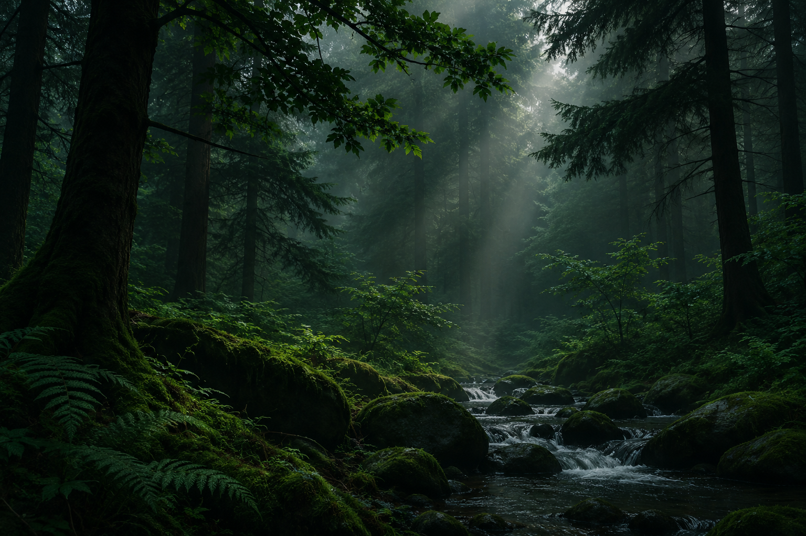
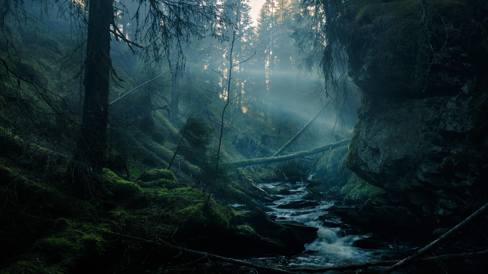
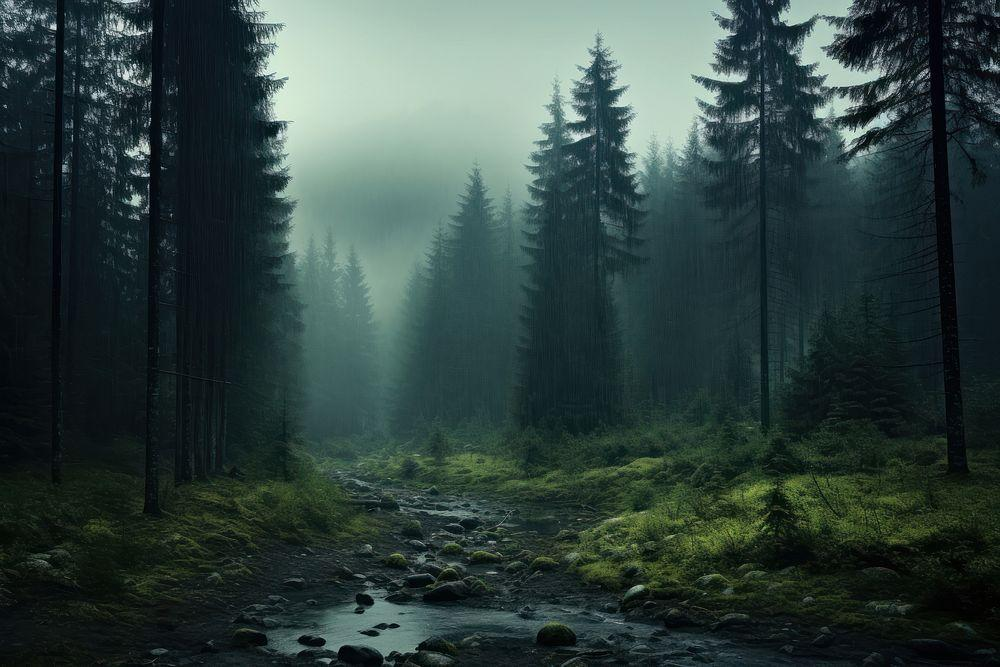
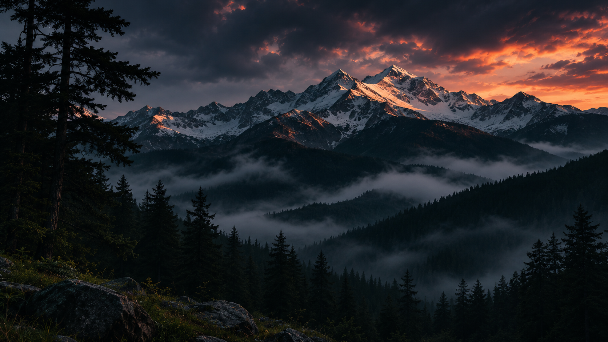
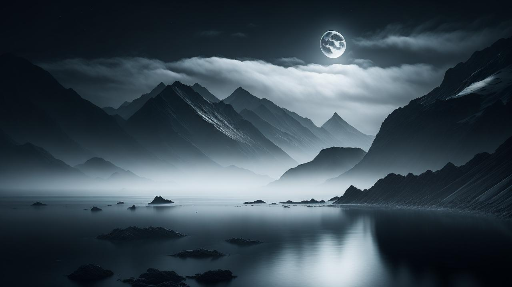
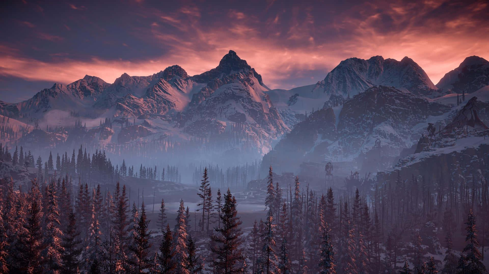
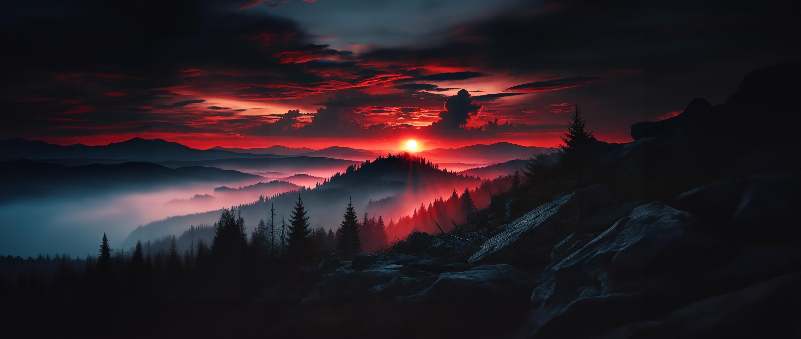
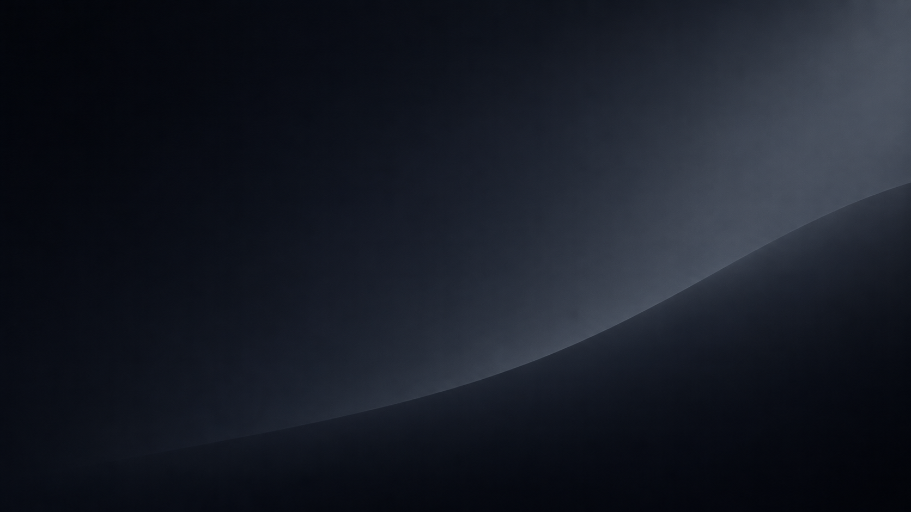

# Wallpapers Collection

Koleksi wallpaper untuk proyek **Terminal Customization Guide**.

Folder ini menyediakan berbagai pilihan gambar latar belakang yang dapat digunakan untuk mempercantik tampilan Windows Terminal.

Setiap wallpaper dikelompokkan berdasarkan kategori, mulai dari pemandangan alam, desain abstrak, hingga tampilan minimalis.

Pengguna dapat melihat preview gambar, memilih wallpaper yang disukai, kemudian menerapkannya pada profil Windows Terminal masing-masing.

> **Tujuan:** Menyediakan koleksi wallpaper yang menarik, terorganisasi, dan mudah digunakan untuk kustomisasi terminal.

---

## Daftar Isi

- [1. Tentang Koleksi](#1-tentang-koleksi)
- [2. Struktur Folder](#2-struktur-folder)
- [3. Nature Collection](#3-nature-collection)
- [4. Abstract Collection](#4-abstract-collection)
- [5. Minimal Collection](#5-minimal-collection)
- [6. Cara Memasang Wallpaper](#6-cara-memasang-wallpaper)
- [7. Konfigurasi Manual](#7-konfigurasi-manual)
- [8. Tips Penggunaan](#8-tips-penggunaan)
- [9. Menambahkan Wallpaper](#9-menambahkan-wallpaper)

---

## 1. Tentang Koleksi

Wallpaper merupakan elemen visual tambahan yang dapat digunakan sebagai latar belakang terminal.

Windows Terminal menyediakan fitur background image sehingga pengguna dapat menggunakan gambar sendiri untuk menyesuaikan tampilan terminal.

Koleksi ini dibuat dengan beberapa konsep desain:

- **Nature:** Pemandangan alam dengan suasana sinematik.
- **Abstract:** Desain modern dengan bentuk dan kombinasi warna.
- **Minimal:** Tampilan sederhana dengan gradasi warna yang lembut.

Semua wallpaper dalam koleksi ini disediakan dalam format PNG.

## 2. Struktur Folder

Berikut struktur direktori wallpaper:

```text
wallpapers/
│
├── abstract/
│   ├── dark-abstract.png
│   └── dark-abstract2.png
│
├── minimal/
│   ├── dark-gradient.png
│   └── dark-gradient2.png
│
├── nature/
│   ├── dark-forest.png
│   ├── dark-forest2.png
│   ├── dark-forest3.png
│   ├── dark-mountain.png
│   ├── dark-mountain2.png
│   ├── dark-mountain3.png
│   └── dark-mountain4.png
│
└── README.md
```

---

## 3. Nature Collection

Kategori Nature berisi wallpaper dengan tema pemandangan alam.

Koleksi ini cocok bagi pengguna yang menyukai suasana natural, tenang, dan sinematik.

### 3.1 Dark Forest

**File:** `nature/dark-forest.png`



Wallpaper hutan dengan pepohonan tinggi, kabut, cahaya alami, dan aliran sungai.

### 3.2 Dark Forest 2

**File:** `nature/dark-forest2.png`



Variasi kedua dari koleksi Dark Forest.

### 3.3 Dark Forest 3

**File:** `nature/dark-forest3.png`



Variasi ketiga untuk pengguna yang menginginkan pilihan wallpaper bertema hutan.

### 3.4 Dark Mountain

**File:** `nature/dark-mountain.png`



Wallpaper pegunungan dengan suasana senja, cahaya jingga, dan kabut di antara pepohonan.

### 3.5 Dark Mountain 2

**File:** `nature/dark-mountain2.png`



Variasi kedua dari koleksi Dark Mountain.

### 3.6 Dark Mountain 3

**File:** `nature/dark-mountain3.png`



Variasi ketiga dari koleksi Dark Mountain.

### 3.7 Dark Mountain 4

**File:** `nature/dark-mountain4.png`



Variasi keempat untuk melengkapi pilihan wallpaper pegunungan.

---

## 4. Abstract Collection

Kategori Abstract berisi wallpaper dengan desain modern dan komposisi visual yang lebih artistik.

### 4.1 Dark Abstract

**File:** `abstract/dark-abstract.png`


Wallpaper abstrak dengan perpaduan warna gelap dan aksen biru yang memberikan kesan modern.

### 4.2 Dark Abstract 2

**File:** `abstract/dark-abstract2.png`


Variasi kedua dari koleksi Dark Abstract.

---

## 5. Minimal Collection

Kategori Minimal ditujukan bagi pengguna yang menyukai tampilan sederhana, bersih, dan tidak terlalu ramai.

Wallpaper dalam kategori ini cocok digunakan sebagai background terminal karena komposisinya lebih sederhana.

### 5.1 Dark Gradient

**File:** `minimal/dark-gradient.png`



Wallpaper minimalis dengan perpaduan warna hitam, charcoal, dan abu-abu.

### 5.2 Dark Gradient 2

**File:** `minimal/dark-gradient2.png`


Variasi kedua dari koleksi Dark Gradient.

---

## 6. Cara Memasang Wallpaper

Wallpaper dalam repository ini dapat digunakan pada aplikasi **Windows Terminal**.

Ikuti langkah berikut untuk memasangnya.

### Langkah 1 — Pilih Wallpaper

Buka folder kategori yang tersedia:

```text
assets/wallpapers/
```

Pilih salah satu gambar yang ingin digunakan.

Contoh:

```text
assets/wallpapers/nature/dark-forest.png
```

### Langkah 2 — Tentukan Lokasi Wallpaper

Ada dua pilihan untuk menyimpan wallpaper.

**Pilihan A: Menggunakan langsung dari folder repository**

Jika repository tetap berada di lokasi yang sama, kamu bisa menggunakan alamat gambar dari folder repository.

Contoh lokasi:

```text
C:\Dokumen\terminal-customization-guide\assets\wallpapers\nature\dark-forest.png
```

**Pilihan B: Menyalin ke folder khusus**

Kamu juga dapat menyalin wallpaper ke folder khusus, misalnya:

```text
C:\Users\Username\Pictures\Terminal\dark-forest.png
```

Ganti `Username` dengan nama akun Windows masing-masing.

Pilihan kedua berguna jika kamu ingin menyimpan wallpaper secara terpisah dari repository.

### Langkah 3 — Buka Pengaturan Windows Terminal

1. Buka Windows Terminal.
2. Klik ikon panah di sebelah tab terminal.
3. Pilih **Settings**.
4. Pilih profil yang ingin dikustomisasi, misalnya PowerShell atau Ubuntu.
5. Buka bagian **Appearance**.
6. Cari pengaturan **Background image**.
7. Pilih atau masukkan lokasi file wallpaper.

### Langkah 4 — Atur Tampilan Wallpaper

Sesuaikan beberapa pengaturan berikut:

| Pengaturan | Fungsi |
|---|---|
| Background image | Menentukan gambar latar belakang |
| Background image opacity | Mengatur transparansi gambar |
| Background image alignment | Menentukan posisi gambar |
| Background image stretch mode | Menyesuaikan ukuran gambar |

### Langkah 5 — Simpan Pengaturan

Simpan perubahan, kemudian buka kembali profil terminal jika diperlukan.

Wallpaper sekarang akan digunakan sebagai latar belakang profil yang dipilih.

---

## 7. Konfigurasi Manual

Selain melalui pengaturan grafis, wallpaper juga dapat diterapkan melalui file `settings.json` Windows Terminal.

Untuk membukanya:

1. Buka Windows Terminal.
2. Masuk ke Settings.
3. Buka bagian Open JSON file.
4. Cari profil yang ingin dikustomisasi.
5. Tambahkan properti background image ke dalam objek profil tersebut.

Contoh konfigurasi:

```json
{
    "backgroundImage": "C:\\Dokumen\\terminal-customization-guide\\assets\\wallpapers\\nature\\dark-forest.png",
    "backgroundImageOpacity": 0.15,
    "backgroundImageAlignment": "center",
    "backgroundImageStretchMode": "uniformToFill"
}
```

### Penjelasan Konfigurasi

| Properti | Fungsi |
|---|---|
| `backgroundImage` | Lokasi file wallpaper |
| `backgroundImageOpacity` | Tingkat transparansi gambar, dari 0.0 sampai 1.0 |
| `backgroundImageAlignment` | Posisi gambar pada terminal |
| `backgroundImageStretchMode` | Cara gambar menyesuaikan ukuran terminal |

**Catatan penting:**

- Contoh di atas merupakan potongan properti profil, bukan keseluruhan file `settings.json`.
- Masukkan properti tersebut ke objek profil yang sesuai di dalam bagian `profiles.list`.
- Jangan menghapus konfigurasi lain yang sudah ada.
- Sesuaikan lokasi gambar dengan tempat wallpaper disimpan.
- Nilai opacity dapat disesuaikan agar teks terminal tetap mudah dibaca.

---

## 8. Tips Penggunaan

Agar wallpaper terlihat bagus ketika digunakan sebagai background terminal, perhatikan beberapa hal berikut:

1. Pilih gambar yang tidak terlalu ramai.
2. Gunakan gambar dengan resolusi yang memadai.
3. Atur transparansi sesuai kebutuhan.
4. Pastikan warna teks tetap memiliki kontras yang baik.
5. Gunakan font terminal yang nyaman dibaca.
6. Sesuaikan posisi gambar dengan ukuran jendela terminal.

Wallpaper merupakan elemen tambahan. Keterbacaan teks dan kenyamanan penggunaan terminal tetap menjadi prioritas.

---

## 9. Menambahkan Wallpaper

Koleksi ini dapat dikembangkan dengan menambahkan wallpaper baru.

Panduan penambahan:

1. Siapkan gambar yang dibuat sendiri atau memiliki izin distribusi.
2. Pilih kategori yang sesuai.
3. Simpan gambar dalam format PNG, JPG, JPEG, atau WebP.
4. Gunakan nama file yang deskriptif.
5. Tambahkan preview gambar pada README.
6. Sertakan informasi dan deskripsi wallpaper.

Contoh:

```text
wallpapers/
└── nature/
    └── dark-lake.png
```

Kemudian tambahkan ke dokumentasi:

```markdown
### Dark Lake


```

---

## Referensi

- [Windows Terminal Documentation](https://learn.microsoft.com/windows/terminal/)
- [Windows Terminal Profile Appearance](https://learn.microsoft.com/windows/terminal/customize-settings/profile-appearance)

---

**Bagian dari:** [Terminal Customization Guide](../../README.md)

Koleksi wallpaper ini dibuat untuk membantu pengguna membangun tampilan terminal yang lebih menarik, personal, dan nyaman digunakan.